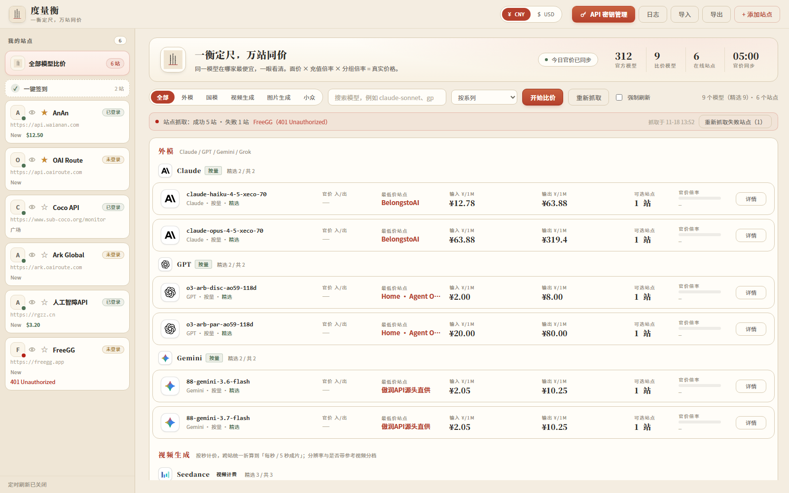
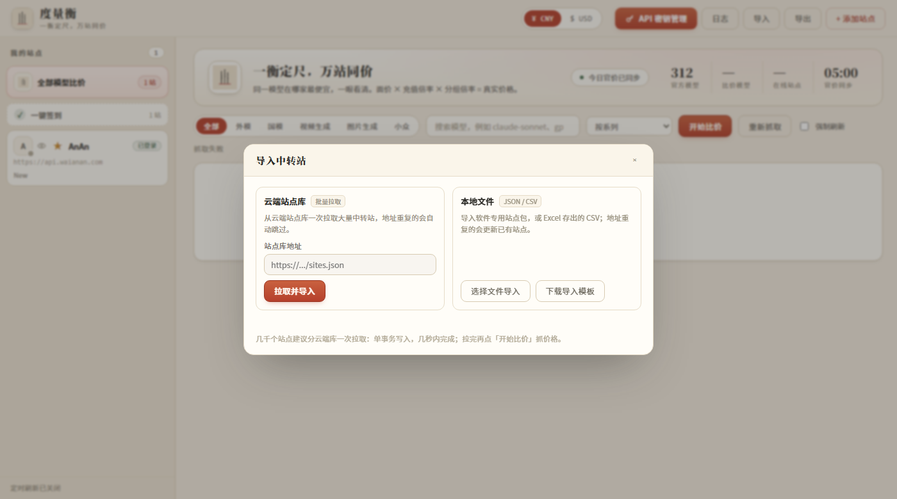

<div align="center">

# 度量衡 · MWB

**一衡定尺，万站同价**

同一模型，在哪家中转站最便宜？一眼看清。

面价 × 分组倍率 × 充值倍率 = 真实价格

<sub>Windows 桌面应用 · 本地存储 · 无需注册 · 公益免费</sub>

<sub>


</sub>



</div>

---

## 名字的由来

公元前 221 年，秦始皇统一六国后做了一件看似琐碎、却影响了两千年的事：**统一度量衡**。

在此之前，齐国的尺、楚国的斗、燕国的秤各说各话。同一批粮食换个国家称，数字就对不上；
不是谁在骗人，只是**尺子不一样**。

今天的中转站也是这个局面。有的标「$1.5 / 1M tokens」再乘分组倍率，有的「充 100 得 200」，
有的按次、按张、按秒、按视频 token 计费。每家算得都对，可放在一起就没法比。

度量衡做的事很简单：把这些碎成一地的计价单位，重新对齐到同一把尺子上——
**同一个模型，同一个单位，同一个价格**。

---

## 这是什么

一个跑在你自己电脑上的 **AI API 中转站比价 + 密钥管理** 工具。

把几十上百个站的价格抓下来，统一折算成「实付人民币 / 每百万 token」，排成一列给你看；
顺手管理各站的 API 密钥，一键导入 CC Switch。

> **软件本体不内置任何中转站数据。**
> 初始是空列表，站点全部由你自己添加，或者从[云端站点库](#云端站点库)订阅一份社区维护的清单。
> 不订阅，就一个站都没有。

### 它解决什么

| 痛点 | 做法 |
|---|---|
| 每家充值比例不同，标价没法直接比 | 折算成「实付人民币 / 每百万 token」，同屏对比 |
| 站点自己算的价和公式对不上 | 用公式反算一遍，差异超过 5% 标 ⚠，提示你核实 |
| 一百多个站一个个点开看太慢 | 并发抓取 + 本地缓存，重开软件秒出结果 |
| 视频模型按秒、按分辨率计费，算不明白 | 解析计费表达式，按分辨率 × 参考视频分档，折算每秒价与 5 秒成片价 |
| 建密钥要进每个站的后台点半天 | 在最低价那一行直接建「只允许该模型使用」的密钥 |



---

## 功能

### 比价

| 能力 | 说明 |
|---|---|
| 面板兼容 | New-API、One-API、Sub2API、Coco 模型广场、通用 OpenAI 兼容接口 |
| 真实价格 | 面价 × 分组倍率 × 充值倍率；站点自己显示的充值价优先，公式校验差异 >5% 标 ⚠ |
| 计费方式 | 按量（每 1M token）、按次、按张、按秒、按视频 token（480p/720p/1080p/4k × 是否带参考视频） |
| 模型分类 | 外模 / 国模 / 视频生成 / 图片生成 / 小众，系列内默认只显示精选 3 条，可展开 |
| 搜索排序 | 输入即搜；按系列、价格高低、官价倍率、可选站点数、模型名排序 |
| 官方价对照 | DeepSeek 官网、LiteLLM、models.dev、OpenRouter 多源同步，显示官价倍率 |

### 抓取

- 并发站点数、单站超时可调（默认 24 并发 / 18 秒）
- 实时进度条、可随时取消，已抓到的结果保留
- 结果落本地缓存，**重开软件秒出**，不用每次重抓上千站点
- 失败站点一键重试（自动放宽超时），并列出失败原因
- 1249 站实测：全量约 11 分钟

### 站点

- 收藏置顶、隐藏某站、按站点只看
- 已登录的站可直接在软件内打开控制台，登录态自动保活
- 账号密码本机加密保存，可自动登录
- 一键签到、余额查询、低余额提醒
- 左侧栏宽度可拖动，会记住

### 密钥

- 在最低价站点一键创建「只允许某模型使用」的密钥，默认命名 `站点-模型-日期-DLH`
- API 密钥管理：按站点分组、复制密钥 / 请求地址、删除、批量删除
- 一键导入 **CC Switch**（Claude Code、Codex、Gemini CLI、DeepSeek Harness、Kimi、OpenCode 等 13 个 CLI）

### 数据

- 导出：软件专用站点包（可再导入）/ 表格 CSV，可选是否包含账号密码
- 导入：JSON / CSV（Excel 直接编辑），逐条容错、按域名去重，3000 条约 1 秒
- 云端站点库：支持多个订阅源，一键拉取社区维护的公开清单
- 分享：把自己在用的站点提交到云端库（只含名称 / 地址 / 类型 / 充值比例，**不含任何凭据**）

---

## 下载与安装

到 **[Releases](../../releases)** 下载最新的 `MWB-v*-win-x64.zip`。

1. **完整解压**到固定目录（例如 `D:\MWB`）——只把 exe 拖出来会启动失败，需要同目录的 DLL、
   `runtimes/` 和 `wwwroot/`
2. 双击 `MWB.exe`
3. 若提示缺少 WebView2，装一次微软的
   [WebView2 Runtime](https://developer.microsoft.com/microsoft-edge/webview2/)（Windows 11 一般自带）

**系统要求**：Windows 10 1809+ / Windows 11，x64。

**首次启动**会在 `%LOCALAPPDATA%\MWB` 建数据目录（SQLite + 加密凭据），
若检测到旧版 *AllApiHubDesktop* 的数据会自动迁移一次。绿色使用：整个文件夹删掉即卸载干净。

---

## 快速上手

1. **加站点** — 右上角「+ 添加站点」，填地址就行，软件自动识别面板类型
2. **登录（可选）** — 站点卡片点 🔐；登录后能抓到需要账号才可见的价格，也能建密钥
3. **开始比价** — 首次会抓取全部站点，进度条在列表上方，可以随时取消
4. **看价格** — 点模型的「详情」，展开各站报价、充值价、公式校验与真实价
5. **建密钥** — 在最低价那一行点「创建单模型密钥」，再到「API 密钥管理」复制或导入 CC Switch

一份给新用户的纯文本说明在 [docs/README-enduser.txt](docs/README-enduser.txt)，可以随安装包一起转发。

---

## 云端站点库

软件不内置站点，但可以订阅 GitHub 上的公开清单。清单单独放在一个仓库里维护：

**[zzyzzy2357/MWB-Sites](https://github.com/zzyzzy2357/MWB-Sites)**

### 拉取（订阅别人整理好的站点）

软件「设置 → 云端站点库」填这个地址即可：

```
https://raw.githubusercontent.com/zzyzzy2357/MWB-Sites/main/sites.json
```

支持**多个订阅源**（换行或逗号分隔），依次拉取、按域名去重。
填好之后「导入 → 云端站点库」就能一键把清单上的站加进来，不用一个个手输。

### 分享（把你正在用的站传上去）

站点编辑窗左下角点「**分享到公共站点库**」：
软件会自动拼好名称、地址、类型、充值比例，打开发布在 MWB-Sites 的提交页，点 Submit 就行。

提交后机器人自动校验地址、按域名去重、合并进 `sites.json`，一分钟左右所有订阅的人就能拉到。

**只有 5 个字段**：`name` / `baseUrl` / `kind` / `rechargeRate` / `note`。
后端做了字段白名单，**账号、密码、密钥不可能被带出去**。

也可以直接去仓库手动提一个 [站点分享 issue](https://github.com/zzyzzy2357/MWB-Sites/issues/new/choose)。

---

## 数据与隐私

- 站点、账号、密钥**只存在本机**：`%LOCALAPPDATA%\MWB\app.db`
- 密码、Cookie、API Key 用 **Windows DPAPI**（当前用户）加密，不落明文
- 软件**没有服务器**，没有账号体系，没有遥测，作者看不到你加了哪些站
- 网络请求只发往：你自己添加的中转站、官方价数据源、汇率源、你订阅的站点清单
- 导出的站点包默认**不含**敏感信息，勾选后才会写入，请自行保管

---

## 常见问题

**抓取失败 / 大量超时**
站点可能挂了、被墙，或需要人机验证。点「重新抓取失败站点」会放宽超时再试。
长期不用的站建议在左侧隐藏，抓取会直接跳过。

**明明登录了，却显示「需登录」**
本地只剩匿名 Cookie（比如 Cloudflare 的 `cf_clearance`）。点站点卡片重新登录一次即可。

**价格显示 `<0.0001` 或「—」**
站点倍率写错会产生 `7e-11` 这种价格，软件判定无效并排除，不会让它污染最低价。

**杀软 / Defender 报毒**
单文件自包含 exe 常被启发式误报。可以加入信任，或把文件丢到
[VirusTotal](https://www.virustotal.com/) 自己核一下。

**视频价格怎么算的**
解析站点的计费表达式，按「分辨率 × 是否带参考视频」分档，先折算**每秒价格**，
再给出 **5 秒成片**参考价。详情里能展开看到原始档位表。

**云端清单里的站可靠吗**
清单由社区提交，只代表「能访问」，不代表价格准、跑路风险低。请自行判断，建议小额测试。

---

## 关于这个项目

MWB 是个人的业余项目，做出来是因为自己确实每天要翻十几个中转站对价格。

- **公益性质**：免费使用，不收费、不插广告、不做会员、不卖数据
- **没有服务器成本**：所有计算和存储都在你本机，所以能一直免费
- **不做引流**：不推荐任何特定中转站，不参与任何返利
- 更新节奏跟着中转站面板的变化走，有问题欢迎提 issue

如果你觉得有用，把它转给同样在比价的朋友就是最好的支持。

---

## 更新记录

见 [CHANGELOG.md](CHANGELOG.md)。当前版本 **2.26.1**。

软件内「设置 → 版本更新」填入本仓库的 Releases 地址，即可检查更新；
也可以手动下载新包覆盖，**数据目录不会被动到**。

## 反馈

有问题或建议请到 [Issues](../../issues)。
请勿在 issue 里贴账号、密码、API Key。

## 免责声明

本软件只是本地的比价与密钥管理工具，**不提供任何中转站服务，也不参与交易**。
中转站的价格、稳定性与资金安全请自行判断，建议先小额测试，风险自负。

## 使用条款

免费使用，不收费。可以自由下载、安装（含商业用途），也可以原样转发安装包给朋友。
请勿改个名字二次打包分发，或把安装包拿去售卖。完整条款见 [LICENSE](LICENSE)。

<div align="center"><sub>

一衡定尺，万站同价。

</sub></div>
